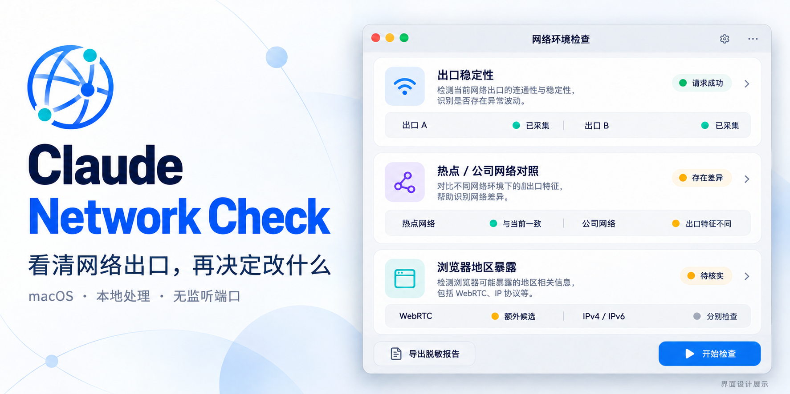
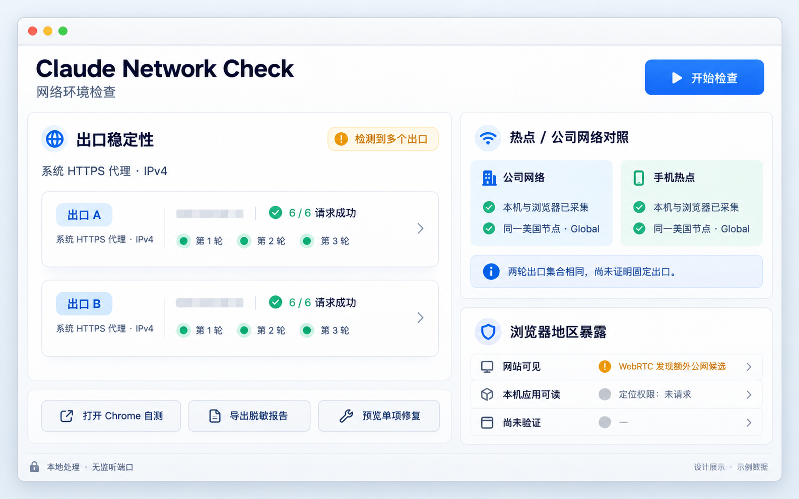

# Claude Network Check｜Claude 网络环境检查

**看清网络出口，再决定改什么。**

[English](README.en.md) · [安装与使用](docs/USER_GUIDE.md) · [隐私说明](docs/PRIVACY.md) · [常见问题](docs/FAQ.md) · [更新记录](CHANGELOG.md)



面向 macOS 的网络环境诊断桌面工具。按请求路径与地址族检查出口 IP，比较手机热点与公司网络，核对浏览器 HTTP、WebRTC 和地区线索，并为系统设置提供可预览、可回读、可恢复的单项调整。

原生 Swift 窗口 + WebKit 界面 + Python 标准库。进程通过标准输入／输出通信，**无本地 HTTP 服务、无监听端口、无需浏览器扩展或 AI API Key**。

## 为什么做这个工具

换了网络，IP 变了；同一个节点，不同应用看到的地区却不同。仅看一个“查询成功”或国家标签，往往无法区分请求分流、IPv4 / IPv6 差异、上游多出口与查询服务失败。

Claude Network Check 把这些证据分开展示，让每一次调整都有依据，也让“尚未验证”有清楚的位置。适合排查 Claude 及其他应用的网络环境；检测站点的结果仍需结合目标应用的实际路径判断。

## 主要能力

| 能力 | 可以查看的结果 |
| --- | --- |
| 三轮出口检测 | 每条请求路径的成功次数、出口地址、国家参考、错误类型与请求耗时 |
| 路径与双栈区分 | 系统代理、探测到的其他本地代理、不显式使用代理的 IPv4 / IPv6 分别比较 |
| 固定 IP 核对 | 地址一致、不同、部分匹配、证据不足分别提示；默认以美国为预期国家 |
| 热点／公司对照 | 手动换网、记录节点与模式备注、逐轮检查网络与代理状态；路径变化时要求重测 |
| Chrome 自测 | 浏览器 HTTP 出口、WebRTC 候选、时区、语言与定位权限状态；复制结果回软件导入 |
| 证据分层 | “网站可见”“本机应用可读”“尚未验证”分开展示 |
| 单项调整 | 时区、地区格式，或一个网络服务的一种代理类型；预览、保存原值、执行、回读与恢复 |
| 脱敏导出 | 用一致的地址代号保留对照关系，隐藏 IP 原文、网络名称、节点备注及公司 DNS 细节 |

## 界面展示



封面与界面图由 AI 辅助生成，使用示例数据呈现设计方向；运行版使用中文原生窗口与卡片界面，实际布局和字段以应用为准。[视觉资产与生成提示词](docs/VISUALS.md)。

## 快速开始

### 运行桌面应用

从仓库 **Releases** 下载与你处理器架构匹配的应用 ZIP，解压后打开 `Claude Network Check.app`。当前随附预构建包为 Apple Silicon（arm64），仍需要可用的 Python 3.9+；Python 不随应用打包。

构建目标为 macOS 13.0+；已在 Apple Silicon、macOS 26.6.1 上完成构建与运行验证，其他系统版本与 Intel 运行情况待验证。应用采用本地 ad-hoc 签名，尚无 Developer ID 签名与 Apple 公证。[详细安装说明](docs/USER_GUIDE.md#安装)。

### 从源码构建

需要 macOS、Xcode Command Line Tools 和 Python 3.9+。Python 无第三方包依赖；Node.js 18+ 仅用于开发测试。

```bash
cd claude-network-check
chmod +x build_app.command 启动工具.command
./build_app.command
open "dist/Claude Network Check.app"
```

自定义输出目录：

```bash
./build_app.command "$HOME/Desktop/Claude Network Check.app"
```

开发工具安装方式见 [Apple 官方文档](https://developer.apple.com/documentation/xcode/installing-the-command-line-tools/)。

## 推荐使用流程

1. 点击“开始检查”或“检查稳定性”，查看当前设置与三轮出口结果。
2. 做两网对照时，手动连接公司网络，记录实际节点和模式，再采集本机结果。
3. 从应用打开 Chrome 自测页，运行、复制、粘贴回应用并导入。
4. 保持节点和模式不变，切换手机热点，完成相同步骤。相邻采样有助于减少时间差干扰。
5. 查看三类证据，导出脱敏报告；需要调整时逐项预览并执行。

“固定 IP 参考”只用于比较，不会改变服务商的 IP 分配。多出口本身不证明掉线；短测成功也不能代表长期可用率。WebRTC 额外地址与 IP 数据库城市属于路径和归属线索，不能据此还原精确物理位置。

## 隐私与权限

- 默认读取当前网络与系统设置；修复由用户逐项触发，必要时使用 macOS 授权窗口。
- 浏览器自测只查询定位权限状态，不请求精确定位、摄像头或麦克风。
- 历史和恢复记录保存在本机，私有目录权限 700、数据文件权限 600。
- 公网检查会连接 ipify、Cloudflare、ipwho.is、ipapi.co；WebRTC 使用 Google STUN。这些服务能看到请求来源，地理数据库还能看到被查询的出口 IP。
- 不读取账号、Cookie、钥匙串、聊天记录或代理订阅凭据。企业 iOA、公司 DNS、VPN/TUN 与浏览器底层偏好不由工具自动改写。

详见 [数据流与隐私说明](docs/PRIVACY.md)、[安全策略](SECURITY.md)。

## 开发与验证

```bash
python3 -m unittest -v test_environment.py test_egress.py test_privacy_audit.py
node test_frontend.js
node test_browser_probe.js
python3 scripts/check_release.py
./build_app.command
codesign --verify --deep --strict "dist/Claude Network Check.app"
```

离线测试通过 mock 覆盖换网、双栈、多出口、国家分歧、固定 IP 比较、浏览器会话、非法导入、权限与修复边界。[架构说明](docs/ARCHITECTURE.md) · [贡献指南](CONTRIBUTING.md) · [验证记录](docs/VALIDATION.md)。GitHub Actions 配置在上传后触发，不以本地验证代替远端运行结果。

## 项目结构

```text
App.swift                    原生窗口、编辑菜单、受限 stdio 桥接
index.html                   中文桌面界面
browser_probe.html           Chrome 自测页
environment.py              本机检查、逐项调整与恢复
egress.py                   三轮出口与路径判断
privacy_audit.py            两网会话、导入、证据与脱敏报告
build_app.command            本机架构构建与签名
scripts/                     发布检查与打包
.github/                     离线 CI 与问题模板
docs/                        使用、架构、隐私、验证与展示资产
```

## 项目信息

版本：**2.2.1**。独立开源项目，与 Anthropic 无隶属关系；名称描述其网络诊断用途。项目使用 [MIT License](LICENSE)，网络查询服务各自适用其服务条款。
