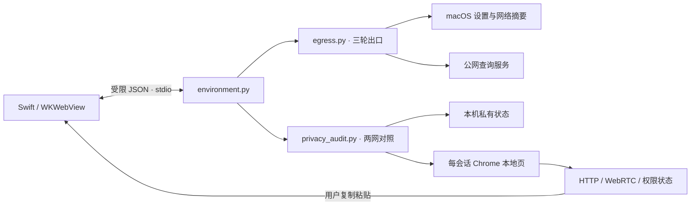

# 架构与判定逻辑

## 运行结构

`App.swift` 只接受主框架中应用自带 `index.html` 的桥接请求，并限制方法、消息尺寸与响应尺寸。WebKit 数据存储为非持久模式。远端页面不进入原生修复界面。

`environment.py` 负责 macOS 读取、地理参考、预览、执行与恢复。`egress.py` 使用 macOS 自带 curl 分路径探测。`privacy_audit.py` 保存两网证据，创建有限会话并导出脱敏报告。浏览器页通过复制粘贴回传，没有本地监听服务。

## 路径与地址族

每条请求标明路径、期望地址族、服务、轮次、返回地址族、出口和连接结果。不同代理路径以及 IPv4 / IPv6 分开汇总。强制 IPv6 查询返回 IPv4 时保留实际返回值，但不把 IPv6 标为成功。

当前本地代理发现涵盖有效系统代理与已知本地端口候选，不能覆盖所有自定义代理、浏览器扩展和 PAC。无显式代理的请求仍可能通过 TUN、VPN 或公司上游网关。

## 状态与结论

每轮及采样结束核对网络摘要、代理、默认／TUN 路由和 DNS 摘要。变动会使同一路径结论失效，要求重测。固定 IP 不匹配、部分匹配、国家分歧、国家不符和国家未取得单独判定。请求耗时为成功 HTTP 请求观测，不是 RTT。

两网因果对照要求有效样本、不同可区分网络特征、相同代理与节点备注、相同客户端运行状态，以及不超过三十分钟的采样间隔。节点备注来自用户，网络摘要也不能保证唯一识别所有网络。因此即使条件齐全，仍需保留证据来源及外部变化的可能性。

## 修复边界

操作计划在进程内保存，有效参考与当前网络条件会在执行前重新检查。修复按时区、地区格式，或网络服务 × 代理类型选择。原值写入私有恢复记录，写后回读；第三方后来修改过的值不会被恢复动作静默覆盖。

新增本地代理启用要求已配置的本地端点可连接，且设备明确不受管理、iOA 未运行。预览与执行均检查条件，服务器、端口与凭据不由此操作重写。

## Python 与构建

原生启动器检查 Homebrew、python.org 和 Apple 开发工具常见位置的 Python，确认版本至少 3.9、低于 4.0 并可导入 `zoneinfo`。工作进程使用 `-B -E -s` 禁止在应用资源目录写入字节码缓存，并忽略 Python 环境变量与用户 site-packages。Python 不随应用附带。

`build_app.command` 在临时生成目录编译本机架构，以 macOS 13.0 为部署目标，复制明确列出的资源，执行本地 ad-hoc 签名，再输出到 `dist/` 或指定 `.app` 路径。应用未经过 Developer ID 签名或公证。
